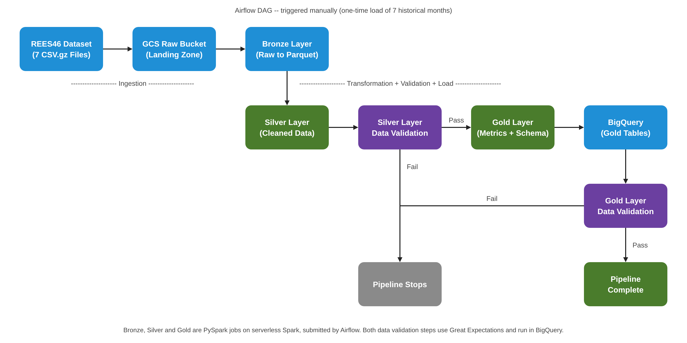

# E-commerce Clickstream Pipeline

A batch data pipeline that processes about 400 million e-commerce events from the REES46 dataset on Google Cloud. PySpark jobs on serverless Spark clean the data and build the Bronze, Silver and Gold layers, the Gold layer data is loaded into BigQuery, Great Expectations validates the data after the Silver layer and after the load, and Apache Airflow runs the whole thing.

---

## Architecture



---

## Tech Stack

| Layer | Tool | Purpose |
|---|---|---|
| Storage | Google Cloud Storage | Raw zipped csv files and the Bronze, Silver and Gold layers as Parquet files |
| Processing | PySpark on serverless Spark (Dataproc) | Clean and model 400M+ rows |
| Warehouse | BigQuery | Gold layer tables, partitioned and clustered |
| Data Quality | Great Expectations | Data validation: 13 checks on the Silver layer and 8 on the Gold layer, run as SQL in BigQuery |
| Orchestration | Apache Airflow (Astro CLI) | Manual orchestration since data is a one-time upload |

---

## Pipeline

The DAG runs the Spark jobs in order, with a data validation step after the Silver layer and after the BigQuery load. A full run takes about 35-40 minutes to reach the BigQuery load.

### 1. Bronze Layer

Reads the seven `.csv.gz` files, applies a fixed schema and writes them as Parquet, with a `year_month` column added. `event_time` stays as text, so a format mismatch cannot quietly turn into empty values.

### 2. Silver Layer

Converts `event_time` to a real timestamp, fills missing `brand` and `category_code` with `unknown`, and removes exact duplicate rows (1,384,422 rows, 0.34%). Nothing else is dropped, because profiling found no missing IDs, times, event types or prices.

### 3. Silver Layer Data Validation

Great Expectations runs 13 checks on the Silver layer through a BigQuery external table, so BigQuery does the heavy lifting and all 400M+ rows are checked in about 12 seconds. A few of them:

- Row count between 400M and 420M
- Exactly the 10 expected columns
- No empty values in the key columns
- Event type is only view, cart, remove_from_cart or purchase
- Purchase price is above zero

If any check fails, the pipeline branches to a `silver_validation_failed` task and no Gold job runs.

### 4. Gold Layer

Four Spark jobs build the Gold layer:

- **Sessions**: one row per session, using the session ID from the data.
- **Funnel**: sessions with a view, cart and purchase for each month, and cart abandonment.
- **Customers**: last purchase, number of orders and total spent for each buyer.
- **Schema**: `fact_events`, `dim_product` and `dim_customer`.

### 5. BigQuery Load

Four `LOAD DATA OVERWRITE` statements load the Gold Parquet files into BigQuery. `fact_events` is partitioned by month and clustered by event_type and product_id. In one test, a query for daily purchase revenue in February 2020 read about 0.03 GB on this table, against about 8.4 GB on the Silver layer.

### 6. Gold Layer Data Validation

Great Expectations runs 8 checks on the loaded tables: no empty `event_date`, `user_id` or `product_id` in the fact table, purchase price above zero, and `product_id` and `user_id` not empty and unique in their dimension tables. If any check fails, the pipeline branches to a `gold_validation_failed` task.

---

## Data

- **400M+ events** across 7 months, from Oct 2019 to Apr 2020
- 16.45 GiB compressed, about 53 GB unzipped
- Historical data: it ends in April 2020 and will not grow, so this is a one-time load of 7 months, not a live feed
- Source: [REES46 e-commerce behaviour data on Kaggle](https://www.kaggle.com/datasets/mkechinov/ecommerce-behavior-data-from-multi-category-store), collected by the REES46 Marketing Platform via the Open CDP project.

---

## Running Locally

### Prerequisites

Before running this project you will need:

- Python 3.13+
- Docker Desktop
- [Astro CLI](https://docs.astronomer.io/astro/cli/install-cli) for running Airflow locally
- [gcloud CLI](https://cloud.google.com/sdk/docs/install)
- A [GCP](https://cloud.google.com) project with the Cloud Storage, BigQuery and Dataproc APIs enabled, two buckets (raw and processed) and a BigQuery dataset, all in the same region
- A GCP service account with these roles: BigQuery Data Editor, BigQuery Job User, Storage Object Admin, Dataproc Worker, Dataproc Editor and Service Account User
- The seven REES46 `.csv.gz` files from Kaggle

### Setup

Clone the repo:

```bash
git clone https://github.com/DataChaser/data_engineering_portfolio
cd ecommerce-clickstream-pipeline
```

Copy the sample environment file and fill in your credentials:

```bash
# on Mac/Linux
cp .env.example .env
# on Windows
copy .env.example .env
```

Open `.env` and fill in:

```
GCP_PROJECT_ID=
GCP_REGION=
GCP_SERVICE_ACCOUNT=
GCS_RAW_BUCKET=
GCS_PROCESSED_BUCKET=
BQ_DATASET=
GCP_CREDENTIALS_PATH=
```

Put your GCP service account key file in the credentials folder (or the path you have supplied in `GCP_CREDENTIALS_PATH` in .env). The path is relative to the project root, for example `credentials/key.json`.

Upload the raw files, and the Spark scripts so Google can run them:

```bash
gcloud storage cp "path/to/datasets/*.csv.gz" gs://<raw-bucket>/events/
gcloud storage cp src/*.py gs://<processed-bucket>/code/
```

### Run the pipeline in Airflow

```bash
astro dev start
```

Open `http://localhost:8080` and trigger the `ecommerce_clickstream_pipeline` DAG manually. This runs the full pipeline from the raw files to the checked Gold tables in BigQuery.

The Silver layer data validation reads an external table over the Silver layer files. After the first Silver run, create it once by running `src/silver-external-table.sql` in the BigQuery console, then clear the `check_silver` task so the run carries on.

### To run the validation directly

```bash
python src/validate.py
```

---

## Key Design Decisions

**Parquet first, one layer at a time**: The slow gzip read happens once, in Bronze. The raw files are never touched, so any later mistake can be fixed by running again from them.

**The Silver layer only cleans, it does not drop rows**: Data profiling found no missing IDs, times, event types or prices, so dropping rows would only lose good data. Odd values are caught by the checks instead.

**Great Expectations runs through BigQuery**: Serverless Spark does not come with Great Expectations, and adding it needs a custom image. A BigQuery external table over the Silver layer files lets Great Expectations send SQL from the laptop or Airflow, and BigQuery does the work.

**Monthly partitions on the fact table**: One day of data is only about 150 MB, too small to be worth its own partition, so `fact_events` is partitioned by month and clustered by event type and product.

**Data validation after the Silver layer and after the Gold layer, kept short**: if a check fails, the pipeline stops before bad data moves on. There are 13 checks on the Silver layer and 8 on the Gold layer, each written from numbers seen in the real data. One weakness: a failed check ends in a `..._failed` task, which still counts as a finished task, so the run shows green. The Graph view shows which branch ran.

**No schedule and no sensor**: the data is historical, so there is no new file to wait for and nothing to run every month. The DAG is started by hand.

**Cart abandonment is a rough number**: the data has no `remove_from_cart` events, so abandonment means a cart and no purchase in the same session. Some purchases also have no cart event, mostly in Oct and Nov 2019, so the number is only reliable from December 2019. For session length, use the median (42 seconds), because a few very long sessions push the average up to about 11 hours.
