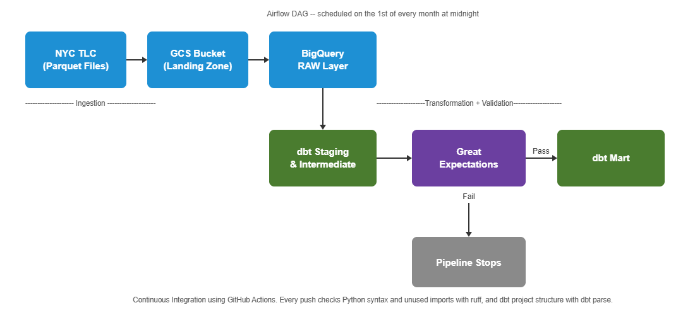

# NYC Yellow Taxi Data Pipeline

A batch data pipeline that ingests NYC TLC Yellow Taxi trip records from the TLC public dataset, loads them into BigQuery via GCS, transforms them with dbt, validates data quality with Great Expectations, and is fully orchestrated by Apache Airflow.

---

## Architecture



---

## Tech Stack

| Layer | Tool | Purpose |
|---|---|---|
| Extraction | Python, requests, pyarrow | Download monthly Parquet files from NYC TLC |
| Storage | Google Cloud Storage | Landing zone for raw Parquet files |
| Warehouse | BigQuery | Raw and transformed data |
| Transformation | dbt | Staging/intermediate views + mart models |
| Data Quality | Great Expectations | Validation checks on staging models |
| Orchestration | Apache Airflow (Astro CLI) | Scheduled DAG, runs 1st of every month at midnight |
| CI | GitHub Actions | Ruff lint + dbt parse on every push |

---

## Pipeline

The DAG runs automatically on the 1st of every month at midnight, processing the previous month's data.

### 1. Extract and Load

A download script fetches the previous month's Parquet file from the NYC TLC public dataset and uploads it to Google Cloud Storage. A load script then runs a BigQuery load job from GCS into the RAW layer, alongside the zone lookup table. Ingestion is idempotent, that is, if a month data is already loaded, the script skips it.

### 2. dbt Staging

Builds two views on top of the RAW tables. `stg_trips` casts types, renames columns, and adds `pickup_date` and `trip_duration_minutes` as derived columns. `stg_zone_lookup` does a casts and renames certain variables on the zone reference table. dbt tests run after staging to validate the output. Then an intermediate model joins `stg_trips` to `stg_zone_lookup` on both pickup and dropoff location IDs, adding borough and zone names to every trip row.

### 3. Great Expectations Validation

Runs 3 checks against the staging models filtered to the month in question before the mart is built:

- Row count between 3M and 7M
- Required columns present
- Median fare amount between $5 and $50

If any check fails the pipeline branches to a `validation_failed` task and the mart is never built. Bad data never reaches the analytical layer.

### 4. dbt Mart

Four mart models are built on top, all materialised as tables: `mart_daily_revenue` aggregated by pickup date and borough, `mart_trip_duration` aggregated by trip date and borough, `mart_pickup_zones` aggregated by pickup zone and hour of day, and `mart_payment_summary` aggregated by payment type. 

### 5. dbt tests

33 dbt tests pass across all layers covering not null, unique, accepted values, and referential integrity.

---

## Data

- **Approx 50 million rows** across 12 months, from Sep 2025 to Aug 2026
- **Zone lookup table**: 265 rows covering all NYC taxi zones and boroughs
- Source: [NYC Taxi and Limousine Commission](https://www.nyc.gov/site/tlc/about/tlc-trip-record-data.page)

---

## Running Locally

### Prerequisites

Before running this project you will need:

- Python 3.13+
- Docker Desktop
- [Astro CLI](https://docs.astronomer.io/astro/cli/install-cli) for running Airflow locally
- A [GCP](https://cloud.google.com) service account with GCS read/write and BigQuery access, and a GCS bucket created

### Setup

Clone the repo:

```bash
git clone https://github.com/DataChaser/data_engineering_portfolio
cd nyc-taxi-data-pipeline
```

Copy the sample environment file and fill in your credentials:

```bash
# on Mac/Linux
cp .env.example .env
# on Windows
copy .env.example .env
```

Open `.env` and fill in:

```
GCP_PROJECT_ID=
GCS_BUCKET_NAME=
GCP_CREDENTIALS_PATH=
BQ_DATASET_RAW=raw
BQ_DATASET_STAGING=staging
BQ_DATASET_MART=mart
```

### Run the pipeline in Airflow

```bash
astro dev start
```

Open `http://localhost:8080`, trigger the `nyc_taxi_pipeline` DAG manually. This will run the full pipeline from downloading the data to building and testing the mart models. If any part of the pipeline fails or the data validation checks fail, the pipeline stops.

### To run the extract and load scripts directly

```bash
python src/extract.py
python src/load.py
```

### To run the validation directly

```bash
python src/validate.py
```

---

## CI

Every pull request to `main` runs two checks automatically:

- **Ruff lint**: Checks `src/` and `dags/` for syntax errors, unused imports, undefined variables, and f-string errors
- **dbt parse**: Validates all SQL models and Jinja templating without connecting to BigQuery

---

## Key Design Decisions

**GCS as a landing zone**: Raw Parquet files land in GCS before BigQuery. If anything fails downstream, the source files are always there to replay from without re-hitting the TLC dataset.

**Incremental marts where appropriate**: only applied where a date dimension exists and new data adds new rows. All-time aggregations stay as full table refresh to avoid incorrect results.

**Great Expectations validation after staging**: Great Expectations runs between staging and mart. If validation fails, the pipeline stops and the mart is never built. Bad data is caught before it reaches the analytical layer. An additional layer of dbt tests is implemented at the staging and mart layers.

**Idempotent ingestion** : Running the pipeline multiple times for the same month produces the same result. Safe to rerun without manual cleanup.

---
